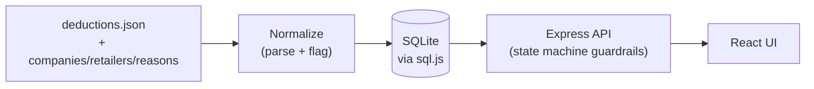
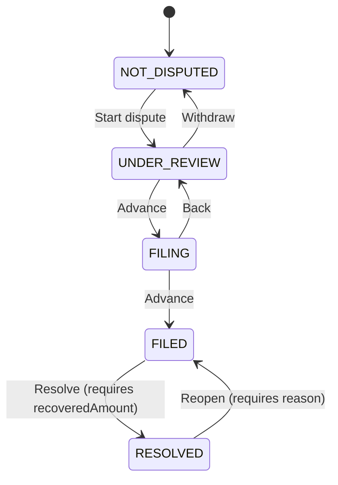

# Deduction Recovery

A small internal tool for tracking retailer deductions and chasing down the ones worth disputing.

Built for the Confido take-home. Stack: Node/TypeScript/Express/SQLite on the
backend, React/TypeScript/Tailwind on the frontend.

## Design Philosophy

An analyst's goal isn't to organize deductions, it's to recover money.
Every decision in this project was evaluated against one question: does it
reduce time-to-recovery, increase confidence in data that's often wrong, or
prevent an invalid step in the dispute workflow? So, please read everything below
through that lens. The normalization layer exists because untrustworthy
data is worthless no matter how nice the UI is, the state machine exists
because an ambiguous process can't be trusted to run correctly at scale,
and the recovery rollup exists because "we filed some disputes" isn't an
answer to "is this working?"

## How to run it

Requires Node 18+. No native compilation, no minimum-version-specific
built-in module. The database layer is pure JavaScript/WebAssembly (see
"Why sql.js" below), so this should install and run the same way regardless
of what Node version you have.

```bash
# 1. Backend: install, ingest the export into SQLite, then serve the API
cd backend
npm install
npm run ingest     # reads data/*.json, normalizes, seeds app.db (idempotent - re-run any time)
npm run dev         # http://localhost:4000

# 2. Frontend, in a second terminal
cd frontend
npm install
npm run dev         # http://localhost:5173 (proxies /api to :4000)
```

Open `http://localhost:5173`. There's no login - pick a company from the
switcher in the header and you're looking at that company's deductions only.

To run the backend's unit tests:

```bash
cd backend
npm run test
```

(27 tests, all in `src/normalize`, `src/state-machine`, and `src/db` - see "Testing philosophy" below for why the tests live there and nowhere else.)

## What this is, in one paragraph

An analyst needs to look at a pile of retailer deductions, tell which ones are
worth fighting, push the ones they've decided to dispute through a process
until the retailer responds, and see, across every retailer over time, 
whether that effort is actually paying off. That's the whole product: a
**normalization layer** that turns the messy export into something trustworthy
(and makes what it couldn't trust visible instead of hiding it), a
**dispute state machine** that models the actual multi-stage process instead
of a free-text status field, and a **recovery rollup** that answers "is this
working?" rather than just listing rows.

## Architecture

```
backend/
  data/                 the four JSON files, unmodified
  src/
    normalize/           parsing layer: raw export row -> NormalizedDeduction + flags
    state-machine/        dispute stage transitions + guardrails (pure functions, no I/O)
    db/                   SQLite schema + ingest script
    routes/                Express routes (deductions, disputes, recovery)
frontend/
  src/
    components/           CompanySwitcher, DeductionsTable, DisputeDrawer, RecoveryDashboard
    lib/                   API client, shared types, formatting helpers
```



The JSON export is treated the way a real ERP export would be, as something you
periodically ingest into a durable store, instead of something the API reads live.
`npm run ingest` is a separate, explicit, idempotent step from `npm run dev`, and
running it wipes and rebuilds `app.db` from the source JSON. In production
this would be a scheduled job pulling from Confido's actual data sources
instead of a one-time file read.

## The data quality work (and what it actually found)

Every raw row goes through `normalizeOne` (`backend/src/normalize/normalize.ts`),
which resolves what it confidently can (retailer name variants, date formats,
string/number amounts, mixed boolean representations) and attaches a `flags`
array for anything it can't. Flags are additive, never silent, meaning a row with an
unrecognized retailer still gets a row in the table, just with an
"Unrecognized retailer" badge next to it, and its raw JSON is always one click
away in the dispute drawer. Nothing gets dropped except exact duplicate IDs
(and those are logged at ingest time, not just silently discarded).

Two things worth knowing about, because they came out of actually looking at
the data:

- **A batch of 39 records is dated 2028**, sitting among ~970 records
  otherwise dated across 2026. My first pass flagged "future" dates by
  comparing against the wall clock, which was useless here, since a static export
  covering a full calendar year naturally contains dates later in the year
  than whenever you happen to read it, so it flagged 40% of the dataset as
  "future" and told the analyst nothing. I reworked it to compare each date's
  year against the *dataset's own modal year* instead. That drops the flag
  count from 417 to the 39 that are actually anomalous; almost certainly a
  keyed-in typo (2028 for 2026) rather than 39 legitimately future-dated
  deductions. This is in `normalizeAll`, tested in
  `normalize.test.ts`.
- **The legacy export has no field for how much was actually recovered.**
  Rows with `status: "Complete"` just say the dispute is over, rather than whether
  the retailer paid in full, partially, or denied it. Instead of assuming $0
  (which would tank the recovery rate) or full credit (which would inflate
  it), ingestion seeds these as `RESOLVED` with `recovery_amount_known =
  false`, and the recovery rollup computes its rate only over disputes where
  the amount is actually known, surfacing the "56 resolved, recovery unknown"
  count as its own number instead of quietly excluding or including them. See
  "What 'recovered' means" below.

Retailer/reason matching (`backend/src/normalize/match.ts`) is slug-based
containment matching plus a small alias table for abbreviations that
containment can't catch (`GFC` -> Gordon Food Service, `UNFI`/`U.N.F.I.` ->
UNFI). It resolves things like `"KEHE\t"`, `"  KeHE"`, `"K e H E"`, and
`"KeHE Distributors LLC"` to the same canonical retailer.

## The dispute state machine



- **NOT_DISPUTED**: the default. Most deductions never leave this state - most
  deductions shouldn't be fought.
- **UNDER_REVIEW**: analyst has flagged it as worth a look, gathering
  documentation.
- **FILING**: dispute drafted, not yet sent to the retailer.
- **FILED**: sent, awaiting the retailer's response.
- **RESOLVED**: terminal. Requires a recovered amount (0 is a valid "denied").

Transitions are validated in `backend/src/state-machine/dispute.ts` -
pure functions with no database access, so the guardrails can't be bypassed by
calling the DB layer directly and can't drift from what the UI happens to
render as a button. Stage-skipping is rejected, resolving without an amount is
rejected, a recovered amount above the deduction amount is rejected, and
reopening a resolved dispute requires a written reason (itself becomes part of
the audit trail in `dispute_events`).

## What "recovered" means

A retailer agreeing to a dispute doesn't mean they pay all of it back. So
"recovered" is tracked as an amount, not a boolean, and every resolution is
classified as `RECOVERED_FULL`, `RECOVERED_PARTIAL`, or `DENIED` based on how
that amount compares to the original deduction. The recovery dashboard rolls
this up two ways: **by stage** (how much money is sitting at each point in the
pipeline) and **by retailer** (which ones actually pay out versus which ones
mostly deny). The headline recovery rate is `recovered / disputed`, computed
only over disputes with a known recovered amount - see the note above about
the legacy export's missing recovery data.

## Assumptions

- One analyst = one company at a time. There is no cross-company view or
  role model; `companyId` is a required query parameter everywhere, and the
  UI's company switcher is the only way to change it.
- Soft-deleted deductions (`is_deleted: true`) are excluded from the default
  view. The API supports `includeDeleted=true` if that's ever needed, but the
  UI doesn't expose it. A deleted deduction is assumed to mean "this was
  pulled back before it reached the analyst," not "hide the money."
- `company_id` values that don't match any row in `companies.json` (3 and 0
  both appear in the export) are preserved and flagged rather than dropped,
  but they'll never show up in any company's scoped view since there's no
  matching company to select. In production these would probably route to an
  ops queue rather than sit invisible.
- Amounts are normalized to their absolute value (44 rows arrived negative).
  A `SUSPICIOUS_AMOUNT_MAGNITUDE` flag exists for amounts over $100k (11
  rows, including one at $50.5M that's almost certainly a data-entry error
  with extra zeros) but these are still included in rollup totals rather than
  excluded. Flagging is meant to direct an analyst's attention, not make a
  silent judgment call about what counts as real money.
- Reasons like "Misc" and "Other" are treated as genuinely unresolved rather
  than mapped to a code. There's no reasonable canonical guess for what they
  mean, so they get a "Missing reason" flag instead of a wrong one.

## Tradeoffs

- **No auth, no multi-user concurrency handling.** This is a single-analyst
  demo; a real version needs sessions and per-user attribution on every
  dispute event.
- **SQLite, via sql.js, not Postgres.** Right choice for a take-home (real
  SQL - joins, aggregates, `FILTER (WHERE ...)` - and a real durable store
  instead of in-memory state that vanishes on restart) but not what I'd
  reach for with concurrent writers. I went through two other options before
  landing here, worth being upfront about: `better-sqlite3` (the usual
  choice) ships prebuilt binaries only for specific Node versions and falls
  back to compiling from source via node-gyp, which needs a C++ toolchain,
  when none matches; Node's built-in `node:sqlite` avoids that but only
  exists on Node 22.5+ and is still explicitly experimental. Since the whole
  point of a take-home is that someone else can just run it, I didn't want
  "install Visual Studio Build Tools" or "you have the wrong Node version" to
  be the first thing standing between a reviewer and the app. `sql.js` is
  pure JavaScript + WebAssembly compiled from SQLite itself, meaning no native
  addon, and no minimum Node version beyond what any current LTS already
  supports. The real cost: sql.js has no built-in file-backed mode, so
  `backend/src/db/client.ts` persists by serializing the whole in-memory
  database to disk after every write. Fine at this scale (fractions of a
  second); the wrapper disables that during bulk ingestion and persists once
  at the end instead, since doing it per-row across ~1,600 insert statements
  would add up. A real production system would use a proper server-backed
  Postgres instead of working around SQLite's constraints at all.
- **No AI-assist feature.** I considered a "suggest a dispute reason"
  heuristic but cut it. A 90-minute-scoped pilot project is exactly the wrong
  place to bolt on something that reads as a gimmick if it's not genuinely
  useful, and everything it could plausibly suggest is already visible in the
  reason column.
- **Test coverage is deliberately narrow, not broad.** Unit tests live only in
  `normalize/`, `state-machine/`, and `db/client.ts`, which are the places where a
  subtly wrong answer (a misparsed date, a stage transition that shouldn't be
  legal, a silently-NULL column from a parameter-binding mismatch) is expensive
  and easy to get wrong silently. The Express routes and React components are
  exercised by manual end-to-end testing instead (documented in the
  ingest/API/UI commit messages), as broad route/component test coverage would
  cost more time than it'd save in a project this size.
- **The recovery rollup treats all flagged amounts as real money.** I chose
  visibility over automatic exclusion (see Assumptions), but a production
  version would probably let an analyst mark a flagged row as "exclude from
  totals" explicitly.

## Scalability

The tradeoffs above cover *why* the current stack fits a take-home; this
covers specifically *where it would break first* under real load, and what
I'd change, in the order I'd hit these problems as data/traffic grew:

1. **The `disputes` API returns every deduction for a company in one
   response, unpaginated** (`GET /api/deductions?companyId=`). At ~1,000
   rows this is instant. At 100,000+ rows per company, which is plausible for a
   large CPG brand with a long deduction history, that response gets slow
   and the client-side filtering in `App.tsx` (search/stage/flagged, all
   done in the browser over the full fetched set) stops being reasonable.
   First fix: cursor-based pagination plus moving filtering server-side
   into the SQL query instead of post-fetch `.filter()` in React.
2. **The recovery rollup recomputes every aggregate from scratch on every
   request** (`GET /api/recovery/summary`). Fine at this scale, since the
   queries run in single-digit milliseconds, but the `byRetailer` query
   in particular does a full scan with several `FILTER (WHERE ...)`
   aggregates per row group. At real scale I'd either add indexes on
   `retailer_id` and `deduction_source_id` (currently only `company_id` is
   indexed) or, more likely, precompute the rollup into a materialized
   summary table refreshed on a schedule or on write, rather than
   recomputing it live on every dashboard load.
3. **sql.js's persistence model is the hardest ceiling.** As covered in
   Tradeoffs, every write re-serializes the *entire* in-memory database to
   disk. That's a few milliseconds at ~1,000 rows and would become a real
   bottleneck well before six-figure row counts or any concurrent writers.
   Two analysts resolving disputes at the same moment would both be
   racing to write the whole DB file, with no locking or transaction
   isolation between them beyond SQLite's own file-level behavior. This is
   the one piece of the current architecture I'd replace outright, not
   incrementally improve: a real deployment needs a server-backed database
   (Postgres) with row-level locking and connection pooling, not an
   in-process embedded DB at all.
5. **Ingestion currently loads the entire JSON export into memory in one
   pass.** Fine for a 1,000-row file; a real multi-source ingestion
   pipeline (pulling from several ERPs, per the job posting's own
   description of what this becomes in production) would need streaming
   or batched processing, per-source idempotency keys so a re-run doesn't
   double-count, and retry/backoff for source systems that are themselves
   unreliable.
6. **The API layer itself is already stateless per-request**, which is the
   one piece of this that scales for free - once the database moves off
   in-process sql.js to something server-backed, the Express layer can be
   horizontally scaled behind a load balancer with no code changes, since
   it holds no session or in-memory state of its own between requests.

## What I'd improve with more time

- A dedicated "data quality" view. Eight now flags live inline in the table
  and drawer; a separate triage screen (grouped by flag type, with bulk
  actions) would suit an analyst working through a backlog rather than
  reading them off one deduction at a time.
- Bulk actions (start disputes on a filtered set at once).
- A trend view for the recovery rollup (recovery rate over time, not just a
  current snapshot). The data model already supports it via
  `dispute_events`, it's just not surfaced yet.
- Real auth and per-user audit attribution on stage transitions.
- Replacing the alias-table approach to retailer/reason matching with
  something that flags *new* unrecognized variants for an admin to map once,
  rather than requiring a code change every time the export spells a name a
  new way.
